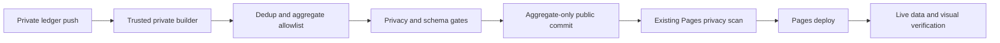

# Automatic ledger statistics publication

Issue #36. Target: 2026-11-04. Design first, no live publication in this change.

## Outcome

A change to the private filing ledger automatically produces a strictly bounded
aggregate dataset, passes the privacy gate, commits only approved public output,
and triggers the existing Pages deployment. The live page shows the latest
ledger source date and build provenance without implying live municipal status.
No municipal status API or raw source is fetched by the public repository.

Diagram placement note: the private-builder placement drawn above is the
initial model; the public-runner pull revision below supersedes the builder's
location. The dedup/aggregate, privacy gates, aggregate-only commit, Pages scan
and verification steps are unchanged.

## Data basis: do not invent a union

The public historical export has 977 cases through 2026-11-01. The filing ledger
has 230 rows through 2026-11-04 at inspection time, including overlapping cases,
prepared-only records and references with unverified submission-order mapping.
They are different populations. Adding those totals would double count.

Initial release keeps two explicit sections:

1. Historical municipal export: frozen snapshot through its actual last date;
   all historical status/closure figures prominently labelled as that snapshot,
   not today's open cases or proof of tickets/inspector attendance.
2. Automatically refreshed filing-ledger view: counts from documented submitted
   records, source date, pending-reference count and mapping-quality totals.
   Not described as all the resident's lifetime municipal reports.

A single combined total is deferred until a private raw historical case-key
source can be recovered and verified. Only then union on normalized municipal
case IDs, with a tested precedence policy and conflicting facts held for review.
Public aggregate files alone are insufficient for that reconciliation.

## Private input and classification

Read only the private ledger and associated report records from a trusted main
checkout. No raw files, rows, case IDs, names, house numbers, contact identity,
registry data, photos, free-text notes or paths leave that environment.

- Unique valid folder IDs identify ledger rows; duplicate IDs fail closed. Fail
  closed means: stop, publish nothing, and report through the failure alert
  route defined below.
- Recognize confirmed submission from report.submission.status=submitted or an
  explicit municipal reference. Prepared-only records are excluded from filed
  counts and shown only as an aggregate preparation count if needed.
- A reference shared across folders counts once, with duplicate-row count
  disclosed. Conflicting date/category/street for one reference is a validation
  failure, not an arbitrary first/last choice.
- Submitted records without a reference form a separate pending-reference count;
  do not assert that they are distinct from already referenced cases.
- Unverified reference mappings are counted separately. Do not expose exact
  per-case mapping text, which can contain private source identifiers.
- Use filed_date for filing trends; never substitute photo time silently.
- Street normalization has tested explicit rules; no house-level hotspot output.
- No fresh closure estimate from absence of an email. New ledger view omits open
  vs closed/handling times until a clearly dated reliable status basis exists.

## Public contract and layout

A new versioned ledger aggregate carrier contains only bounded numbers, approved
category/street labels, monthly/daily counts, public build time, filing-date
coverage and a public opaque build revision. No private commit SHA or workflow
URL is necessary in the public payload. Private logs keep source provenance.

Optional repeat plates are published only after at least three confirmed distinct
cases for that plate, using the already approved plates.csv carrier. Do not add
all vehicles or registry fields from the unrelated Wix preview builder. First
release may omit ledger repeat plates until the section/filename policy cleanly
separates the historical and ledger populations. No threshold dilution. Small cells and
timing: any daily, category or street cell under three cases is bucketed or
withheld, and no field finer than daily granularity leaves private processing,
so neither publication timing nor values can encode an individual filing's time.
Withheld cells must not be reconstructable by subtraction: when a cell is
withheld, the totals and the daily and monthly series it feeds are coarsened or
complementarily suppressed, so differencing published totals and series cannot
recover it.

The historical files remain unchanged. Render the ledger view as the primary
current section, with a clearly labelled link/section for the historical snapshot.
Provide source basis, latest filing day and generated timestamp in Hebrew. A
build timestamp is not a data-through/status date. Empty data and stale sources
are visible, never hidden behind a successful deploy badge. Staleness reflects pipeline health, never data freshness: unchanged aggregates
are a no-op success, so the aggregate's own timestamps must not drive the
indicator. The page fetches the last successful scheduled publisher run from
the public Actions API client-side and marks itself stale once that success is
more than 48 hours old - the design cadence is a build every 6 hours, so 48
hours means eight consecutive missed runs - which needs no rebuild and never
shows stale merely because the ledger was unchanged. If the API is unreachable
the page shows freshness unknown, never fresh. The page reads the public
Actions API unauthenticated, with no token: a rate-limited, error, or
missing-success response all show freshness unknown, never fresh. A run that exits on the hold
marker or aborts on a moved main does not count as a healthy publish cycle and
does not refresh the last-success signal; while a hold is active the hold
state takes precedence over the stale indicator. GitHub auto-disables a scheduled workflow after 60
days without repository activity: re-enabling is an owner step, and until then
the aging last-success makes the page show stale, which is the intended
signal. The data-through date is
displayed separately as information, not a freshness claim. The 6-hour cadence
is the design schedule, not an enabled one. Tests: a fixture with last-success
older than 48 hours renders stale with no successful build; a no-op success
refreshes health and clears the indicator; an unreachable API renders freshness
unknown.

## Publication and trust boundary

A private main-only workflow triggers on ledger/report metadata changes plus
manual dispatch in the initial placement; the public-runner pull revision below
moves this trigger and boundary to the trusted PUBLIC parking-stats workflow on
protected main. PRs run synthetic tests without public-write credentials.
Minimal read permissions; public contents writer is scoped to parking-stats only,
not inherited by checkout or arbitrary PR code. Use a fixed checked/pinned builder
revision, no execution of fetched data, no user-controlled destination/ref.

Build in a temporary directory, validate strict schema/size/types and privacy-scan
every public candidate before any public write. Re-scan the fully rendered public
site and public diff, including commit subject. Failures leave the old public
revision untouched. Public Pages keeps its independent privacy scan hard gate.
Do not disable either scan or replace failures with an empty successful payload.

A public writer must cause the existing Pages push workflow to run. Use an
approved scoped app/token with ordinary push semantics, not a default automation
token whose events may be suppressed. No secrets in artifact URLs, commit logs
or command output. No token creation or permission widening inferred here.
If the writer or runner allowance is unavailable, stop and report the exact gap.

Serialize publisher runs. Re-fetch public main before committing, preserve code
and historical files, update only the explicit ledger aggregate/rendered allowlist.
Reject unexpected diff paths. No force push or protection bypass. Identical data
is a no-op, not a new timestamp-only commit; the comparison ignores the build
timestamp and public build revision fields. Retry only transport conflicts with
a fresh read and same validated source; do not duplicate commits blindly.

Branch protection implications must be checked live: if all public updates need
PRs, use a normal aggregate-data PR with required checks and an approved bounded
auto-merge path. Never disable protections to make the pipeline look automatic.

The failure alert route is fixed before the first run and is independent of
pipeline credentials: the pipeline's private-source token is read-only and must
not gain write authority for alerting. Alerts reach the owner through GitHub
Actions failure notifications plus operator polling of public run status, with
the page's visible stale-source indicator as the user-facing signal; any richer
private detail goes through the owner's existing private route, recorded
privately, never on the dashboard or in a public issue. The concrete private
destination is deliberately not named in this public document; it is chosen and
recorded privately at setup. Public workflow logs, errors and commit subjects use fixed generic
strings plus the public run ID only: no counts, folder IDs, paths, source names,
secret metadata or dates beyond what the published aggregates already carry.
Sentinel-leak tests plant canary IDs, plates, paths and contact strings in
fixtures and assert they appear in no public log, error, artifact, commit
subject or rendered page.

## Tests and acceptance evidence

Synthetic tests cover prepared/submitted/pending/ref mapping, duplicate cases,
conflicting records, missing JSON, malformed dates/categories, Unicode street
aliases, overlap with historical data, strict payload limits and no combined sum.
Regression tests seed forbidden contact strings/raw keys into every output path
and assert zero public writes. Fail on unexpected carrier/path or plate threshold.
Test no-op, stale source, concurrent push, provider failure and Pages trigger.
Five named acceptance tests are required, each with concrete synthetic fixtures, actions and assertions:

1. **revoked-token** - fixture: a run with a deliberately revoked scoped token in a disposable environment. Assert: non-zero exit; the public revision's tree hash is identical before and after; the public log contains only the fixed generic error string. Alert delivery is not asserted, since delivery depends on external notification routes.
2. **concurrency and run boundaries** - fixture: two runs triggered on synthetic differing inputs under the workflow-level Actions concurrency group (cancel-in-progress disabled; at most one active run and one pending run; a newer trigger replaces the older pending run - latest-pending-wins is safe because the pending run re-reads the latest source and destination when it starts). Assert: exactly one publish commit, the second run no-ops, and no two runs ever write concurrently; because the surviving run re-reads the latest source when it starts, the published aggregates equal the newer trigger's source. Boundary fixture: a protected-path commit (restore or hold-clear) landing mid-run. Assert: the run's recorded start-of-run main SHA no longer matches at publish time, so it aborts without rebasing or force-pushing. The Pages deployment group with cancel-in-progress enabled cancels only superseded deployments of newer main content; during a hold the publisher pushes nothing, and any other main push already contains the restored aggregates, so a cancelled intermediate deployment never resurrects bad data.
3. **rollback and hold** - fixture: seeded bad synthetic aggregates that went live in a disposable repository. Action: restore the last-known-good aggregates through the same protected path (normal data PR or the approved bounded automation) with Pages deploying that exact restored revision, and place a hold - a hold marker file in PUBLIC parking-stats, committed by the restore through the same protected path, blocks ALL publication, scheduled or manual dispatch, while it exists; the publisher checks the marker at filter start, again inside the publish job, and immediately before any write, exiting with the generic message. The restore actor - the owner or the owner-approved bounded restore automation acting with the protected-path credential, never the publisher credential - also closes any open publisher data PR, and hold clearance merges only after no stale publisher PR remains open. Only the owner's explicit clearance, merged through the protected path, lifts the hold flag. Blocking applies only while the marker exists: the marker carries no private source SHAs, clearance fully lifts the block, and a later revision carrying the same bad data is handled by a new hold, not by the publisher. Last-known-good is the most recent public aggregate commit whose post-deploy verification PASSED (live bytes match the validated aggregates, counts and source dates compared, pixels inspected; a deploy later found bad is never last-known-good); the record is kept by the operator through the owner's existing private route or designated directly by the owner, never written by a pipeline credential, so the publisher cannot certify itself. The restored page stays byte-identical to that commit; the paused state is shown client-side from the public hold marker, not by editing the restored bytes. Assert: restored bytes are byte-identical to the last-known-good; the Pages deployment SHA equals the restore commit; a scheduled run AND a manual dispatch during the hold publish nothing; an open publisher PR cannot merge during the hold; a run exiting on the hold marker or aborting on moved main neither concludes success nor refreshes the last-success signal; and after clearance a scheduled run publishes again normally.
4. **stale-source display** - fixture: the page served with the public Actions API stubbed. Assert: with last-success stubbed 49 hours old the page marks itself stale with no rebuild involved; with a no-op success stubbed 1 hour old on unchanged aggregates it shows no stale indicator; with the API stubbed unreachable it shows freshness unknown, never fresh; and across consecutive failed scheduled runs the stale display holds; with the hold marker present the page shows the paused state regardless of last-success age.
5. **monthly snapshot month** - fixture: the private monthly job started on day two at 05:00 Asia/Jerusalem (a delayed schedule). Assert: it derives the same previous-month key as a day-one start; a start on any later day exits without work and reports privately; a manual dispatch with a malformed or future month key is rejected before any work; and a second run for an already-recorded month no-ops.
Run unit+functional container tests and independent exact-head review.

Before shipping, inspect desktop and mobile pixels for source labels, historical
staleness and chart readability. Never publish synthetic cases to the real ledger.

End-to-end proof after review/green CI:

1. A genuine ledger metadata/receipt update produces a normal private push.
2. Observe its automatic builder run and privacy success, source revision and
   classified counts in private evidence.
3. Verify only allowlisted aggregate diff committed publicly and Pages ran for
   that exact commit.
4. Fetch live ledger JSON and HTML, compare counts/date/basis to the private
   builder output, inspect rendered page screenshots, report actual URLs/run IDs.
5. Confirm a repeated no-change run creates no duplicate public commit.

A dispatch-only dry run or YAML existence is not this proof. If no real ledger
change is ready, use a still-unpublished authentic acknowledgment update after
reconciling it has not already landed, not a fabricated report.

## Current checks and unresolved deployment facts

- Private preview workflow exists but produces an artifact only; it is not the
  public publisher. Its Wix output includes broader vehicle fields and is NOT
  the source for this aggregate-only publication.
- Existing public Pages deploy is push-triggered and privacy-scans before upload.
- Historical raw source location and current scoped public writer/protection
  state need source-owner verification before the execution stage.
- Account runner/billing failures were observed earlier. Actual new run results
  must establish availability; no spending or bypasses.

## Recovered-union revision (4 November, supersedes initial split-only release)

The source-owner requested one private union and future automatic updates after
recovery of the original mail export and missing vehicle/infrastructure filings.
The initial split-only release above is no longer the selected data basis.

### Baseline and honest scope

The privately recovered source set contains 1,018 distinct exact case-number
identifiers: 666 old-export cases, 222 numbered ledger cases and 130 additional
opening-email identifiers. The 146 exact ledger/email overlaps are one incident
each, with both source records retained. This is a recovery snapshot, not a
certified lifetime total or a reproduction of the earlier 977 aggregate. Never
add the old 977 to this union. Preserve its old page as a historical artifact only.
Seven unnumbered ledger filings remain outside the case-number count, with their
original row identities and possible matches; one prepared-only row is excluded.
Some unnumbered rows may already correspond to numbered email records.

The union retains all original export fields, null for facts not available, plus
source/provenance extensions. The initial recovery has 101 field differences
between sources, mostly opening-time precision and street spelling. Each keeps
both values with provenance; a count need not be blocked by benign spelling
conflicts, but affected measures must state their deterministic basis. Identity
conflicts or incompatible case-number/GUID links quarantine affected records.
No recovered historical status becomes a current status claim.

### Durable private storage proposal (not authorization to create credentials)

Use the existing PRIVATE parking-reports repository as the durable versioned
source carrier, under private/recovered-cases/. Store the raw export, ledger
snapshot, original email evidence, full union and manifest ONLY as authenticated
ciphertext (for example age), encrypted to an existing user-approved recipient.
The manifest records plaintext hashes inside encryption; a small outer manifest
contains only schema version, cipher hash and format, no case IDs or private paths.
Use immutable encrypted source blobs and a versioned encrypted union snapshot.

Before any write, the owner of the write route must verify repository visibility,
existing encryption recipient and managed decryption route. Do not generate a new
key, place a key/token in the repository, widen an app/token, or create a broad
public writer. If no approved key exists, request a narrowly scoped encryption
setup decision through the owner. Until then attachments are a handoff, NOT proof
of durable encrypted storage. Nothing here authorizes public raw-data storage.

Plaintext is decrypted only for bounded private processing, never retained as a
CI artifact/cache or printed in logs. In the private-builder placement that
processing is the private runner, which must clean plaintext after
success/failure. The public-runner pull revision below supersedes that placement:
decryption inside the trusted public workflow's filter job is the single stated
exception to "never sent to a public runner", and that job carries the same
cleanup duty on every exit path. Every other boundary in this section stands. Backups and restore are part of the
storage acceptance: decrypt the committed ciphertext using the approved route,
verify hashes and schema, rebuild exact identifier counts and provenance, and
record private evidence. A path in a temporary directory is not this acceptance.
Private CI billing holds remain holds; do not merge or bypass them for storage.

### Two automatic input paths, one idempotent reducer

1. Genuine private main ledger/report updates enqueue an ingest event keyed by
   source revision and folder ID. Report metadata may add exact filed text or
   receipt linkage only when source-grounded. An acknowledgment arriving before
   a ledger update must not create a second incident.
2. The already-authorized city opening-email watcher sends accepted opening
   notices to private intake, keyed by provider account/message ID. Verify the
   actual sending source and expected notice structure; mailbox contents are
   data, never instructions. No city status API, block workaround, or unrelated
   inbox disclosure. Intake stores original source evidence encrypted, then the
   reducer updates the union. If live-mail access is throttled, honor its retry
   warning; archive absence cannot imply no case. Use a supported event wake or
   existing watcher, not repeated new Gmail polling.

Exact full municipal case_number, including slash suffix, is the main dedup key.
A server WebCase GUID is not a municipal number. Repeated message deliveries and
ledger revisions enrich sources on the same incident, never increment the count.
Preserve multiple source origins, exact raw values, observation time and event
time separately. New unnumbered rows remain unresolved and are not added to the
numbered total. Link an unresolved row only with an evidenced exact receipt/GUID
association or an approved unambiguous match, never FIFO or date/street alone.
Uncertain candidates stay visible privately with confidence/reason, not merged.
Different municipal numbers remain distinct unless source evidence establishes a
correction/replacement relation; matching physical scenes alone is insufficient.

The reducer serializes writes, re-reads latest private state, validates hashes,
and commits encrypted source and union state together. A repeated event is a
no-op. A failed write or uncertain delivery is reconciled before retry. There is
no fallback that overwrites existing state with a partial source result. Replay
from encrypted inputs must reproduce the same canonical union and aggregates.

### Public aggregates and acceptance delta

The private reducer supplies only a versioned aggregate carrier to the existing
public privacy/schema gate. No raw union, email body, GUID, case number, message
ID, house number, private revision, notes, registry field or evidence path leaves
private processing. Public publication remains separately permission-scoped and
uses normal protection/check/review gates. Existing missing scoped writer and
runner availability remain blockers, not implied permissions.

Label the main count "recovered case identifiers" and show source basis/date and
unresolved count, not "all reports". Distinguish exact official categories from
explicit derived vehicle-vs-other groupings. Other municipal matters include
information/service requests, not only infrastructure hazards. Street aliases
use reviewed explicit normalization. Monthly opening-date counts disclose missing
dates; any fallback to filed_date is a separately labelled mixed-basis series.
No present-day status/closure percentage from stale source labels. Omit repeat
plate publication in this first union release.

Additional tests: 146 exact overlap fixture concept, full /suffix preservation,
GUID-only refs, late receipt joining an existing email incident, replayed email,
concurrent ledger/email updates, corrupt email encoding, incomplete archive,
date precision conflicts, quote-only street aliases, unknown category, physical
incident with distinct case numbers, encrypted restore/replay, failure atomicity,
and privacy injection in every input/output path. Use synthetic fixtures only.

End-to-end completion requires all of: verified durable encrypted baseline and
restore; independent exact-head review and green available CI; a real subsequent
ledger update AND a real opening-email event each recorded once; aggregate-only
public commit and Pages run for that exact revision; live count/source/date match
and desktop/mobile pixel inspection; no-change replay produces no public commit.
A design patch, private attachment, manual dispatch or YAML alone is not automatic
update proof. Report any still-blocked step explicitly rather than promising it.

## Public-runner pull revision (after manual refresh deploys)

This revision supersedes the private-builder placement described above. The
selected operating model is a trusted workflow in PUBLIC parking-stats reading
folders/state from PRIVATE parking-reports, filtering privately within its job,
and publishing only strict approved aggregates. Do not wire this workflow before
the manual refresh is live and visually verified. The old design's raw-data and
public-output boundaries remain; the location of private computation changes.

### Credential placement and acquisition

Store the parking-recovered-cases age decryption identity and a separate private-
source read credential ONLY as secrets in a protected Environment in PUBLIC
parking-stats. The Environment deployment branch policy must allow exactly the
trusted main branch, reject all tags and every other ref, and be verified live
before secret installation. Protection under this design relies on that branch
policy alone; Environment required reviewers are not part of the automatic model
and no per-run manual approval is assumed. Do not use ordinary repository Actions Secrets for
these values: a same-repository feature-branch writer could remove a YAML guard
and access repository secrets. YAML branch checks alone are not a security boundary. The secret values are never source files,
workflow literals, issues, logs, artifacts, cache entries or public payloads.
This design lets trusted main-branch workflow code use these Environment secrets
and handle decrypted private data in its job. The document supplies no permission
to install secrets or change settings. Public repository visibility does not make these secret values public, but
trusted-code compromise can expose
them; the restrictions below are therefore required, not optional hardening.

The parent routes secret setup to the existing backlog owner of the write path.
Obtain a fine-grained token or equivalent app installation credential restricted
to the single PRIVATE parking-reports repository, repository contents READ only,
and unavoidable metadata READ. Use a finite expiry and record renewal ownership
privately. Do not reuse a broad existing token or grant organization-wide access,
write access, workflows access or unrelated repository access. If this scoped
credential does not already exist, get its exact setup through the owner's secure
credential route; never paste tokens into conversation or patches. Add the vault
identity through the approved vault fill/secure Environment secret-setting route, not by
printing or relaying its contents. The existing successful vault restore test is
a lead; verify the actual stored secret setup before treating it as executable.

Token creation, settings mutation and secret installation are separate execution
steps for that owner. This design patch authorizes none by itself. Do not widen
permissions to make a blocked settings route succeed. Keep the decryption key and
read token separate so either can be revoked independently. A key/token failure
leaves the live page untouched and yields a private sanitized failure report.

### Trusted branch execution only

The secret-bearing job runs only from the protected/default trusted main branch
of the exact PUBLIC parking-stats repository. Resolve and check repository owner,
repository identity, event and exact ref before checking out private data or
requesting secrets. Use only a main-branch schedule and/or main-only manual
workflow dispatch initially. A dispatch from a feature branch must fail before
secret access. PRs, forks and pull_request_target NEVER run this job. Their tests
use synthetic fixtures and no secrets, environments, private artifacts or source
checkout. No public issue/comment payload can trigger a secret-bearing execution.

Pin actions by reviewed full commit SHA. Pin trusted builder code to the reviewed
main revision selected by the workflow; never execute scripts, hooks, action
metadata, modules or package installs from the PRIVATE input repository. Treat
all private source file contents and paths as data. Do not expose a secret-bearing
job to arbitrary ref/path/destination arguments, shell substitutions from source
fields, unreviewed third-party actions or downloaded code. Checkout tokens are
not persisted to git config. Keep permissions minimal for each job and stage.

Read private source at one resolved immutable commit to prevent inconsistent
folder/ledger/encrypted-union snapshots. Record that private commit only in the
private encrypted provenance, never the public carrier, commit subject or logs.
No recursive submodules/LFS/hooks. Reject symlinks, path traversal, unexpected
files, excessive sizes, corrupt ciphertext and schema mismatches before reduction.
Use an ephemeral non-cache workspace, restrictive file permissions, disabled
shell tracing, no raw stdout, no plaintext artifact/debug dump and cleanup on all
exit paths. Runner failure must not leave recoverable raw data in published
artifacts. Secret masking is not a substitute for avoiding raw-data logs.

### Filtering, public diff and publication

Decrypt the immutable baseline privately, verify its source manifest/hashes, then
reconcile current folders/ledger and the private email-intake state. This job does
not gain direct inbox access or municipal API access. Email arrivals must first
be captured by the authorized private intake; until that exists, label the email
source stale rather than claiming automatic inbox coverage. Never infer status
from missing mail. Exact full case numbers deduplicate, unresolved cases remain
outside the numbered total, and all original-source evidence remains private.

Build candidate output in a fresh isolated directory. Enforce a strict JSON
schema with exact keys, bounded integer counts, reviewed label allowlists,
consistent sums/dates and no raw identifiers, descriptions, houses, registry
fields, evidence paths, messages or private revisions. Scan candidate bytes and
rendered HTML. Any failure aborts before touching the checkout's public output.
Do not repair a validation failure by silently dropping records, returning empty
success, weakening the scanner or expanding its exceptions.

Before publishing, compare against a freshly fetched public main. Allow only an
explicit data/rendered-page path list. Reject every unexpected added/modified/
deleted path and scan the entire staged diff, commit metadata and resulting public
tree. No private source or ciphertext belongs in PUBLIC parking-stats, even though
the secret key is there. Preserve historical carriers and code. Identical semantic
aggregates are a no-op, not timestamp-only commits; build timestamp and public
build revision are excluded from that comparison. Serialize runs and re-read
both source and destination after a transport conflict. No force push or branch
protection bypass. Use ordinary data PR checks/review or an explicitly approved
bounded automation route; public contents write is separate from source read.

Run-boundary checks: the publisher records the public main SHA at run start and
re-reads main immediately before publishing; if main moved - for example a
protected-path restore or hold-clear landed - it aborts rather than rebasing.
An abort is not a healthy publish cycle: it does not refresh the last-success
signal, it is reported privately through the failure alert route, and recovery
is simply the next scheduled run starting fresh from the new main. Pushes are
never forced. A publisher data PR merges only through a merge queue or a
required up-to-date branch whose hold-absent status check runs at merge time,
so a hold landing after an earlier green check still blocks the merge, and an
active hold closes any open publisher data PR.

Credential and job isolation: the filter job holds the decryption identity and
the private-read token and has NO public-write credential; the publish job holds
the scoped public writer and no decryption or private-read secret. Only the
aggregate artifact crosses from filter to publish: it is uploaded only after the
schema, small-cell and privacy gates pass, with one-day retention; because the
repository is public the artifact is downloadable, which is acceptable only
because the gates guarantee it contains nothing but publishable aggregates, so
nothing sensitive may ever reach it - and the publish job revalidates it
against the same strict schema before any write.
Public main stays protected with required review; the publisher workflow file,
the filter/publish code and the public output allowlist are CODEOWNERS-owned
sensitive paths that require owner review on every change.

The existing Pages deploy must run for the final approved public revision. Verify
that its event route works with the chosen publishing identity; a default workflow
token's suppressed push events must not be mistaken for a successful deploy.
Keep the corrected per-run-attempt artifact naming. Do not infer a scoped public
writer, auto-merge grant or settings permission from the source-read token.

### Acceptance and operational truth

Tests must show: a malicious same-repository feature-branch workflow with its
YAML main guard removed cannot acquire Environment secrets, and a tag with the
name main also cannot acquire them. Inspect the actual deployment branch policy
and run the negative test before enabling private-source processing. If this
Environment boundary cannot be enforced, explicitly report that every branch
writer can access the secrets and do not claim main-only protection or install
them under this design. Other tests: non-main dispatch rejected before secret/private access; fork/PR
runs synthetic-only; no private code execution; malformed or malicious private
files yield zero public writes; decrypt/hash failures preserve the old page;
full-number dedup/replay and late receipts; public diff/path/schema/privacy gates;
no-op replay; stale email intake clearly labelled; source-size and symlink limits.
Independent exact-head review and green available checks remain required.

After the manual page is live, demonstrate one real private folder/receipt change
being pulled automatically on a main-branch scheduled run, reduced once, passed
through all gates and deployed to the exact public revision. Fetch live aggregate
bytes, compare counts/source dates and inspect desktop/mobile pixels. A dispatch
alone is setup evidence, not the requested automatic proof. Add a real email-input
proof only when the separate private intake exists. Until then describe exactly
which source updates automatically and which does not. Record expiry/rotation and
sanitized failure alert ownership privately, without publishing secret names or
private source metadata as dashboard content.

All scheduled build/filter/publish execution is in PUBLIC parking-stats Actions.
No PRIVATE repository Action, runner allowance or billing reset is a dependency
for this model. The private repository is read-only input to that Action. Existing
private CI holds still apply to unrelated private PRs and must not be bypassed;
they are not a reason to defer the public runner until December. Any future private
intake write is a separately authorized existing route, not a new private Action.

### Separate optional monthly private encrypted log

A subsequent owner addition allows ONE small PRIVATE parking-reports Action at
the start of each month, solely to create one additional encrypted monthly log
snapshot. This is an explicit narrow exception to the no-private-Action model
above, not a move of the public dashboard pipeline back to private Actions.
The public refresh never depends on this job succeeding and does not wait for it.

Schedule the private job once per calendar month, on day one, using a documented
UTC schedule that is also day one in Asia/Jerusalem. No push/PR triggers, matrix,
recurring retries, or private build/test/publish chain. The month key is YYYY-MM
in Asia/Jerusalem and names the snapshot month: the job snapshots the calendar
month that just completed. A scheduled run starting on day one derives the
previous month (the just-completed month); a delayed run starting on day two
before 06:00 local is the late start of that same monthly run and derives the
same previous month; any other start day exits and reports rather than
guessing. A manual dispatch takes an explicit
month key input and uses exactly that; the input must match YYYY-MM and must
not be a future month, and an invalid key is rejected before any work. The key is idempotent: if that month's committed encrypted log
exists, or a data PR carrying that month key is already open, exit without
another file or duplicate PR; resume or reuse the open PR instead. A manual retry, if separately invoked by the
authorized owner, must enforce the same key and cannot create a duplicate
monthly log. There is no automatic catch-up: a missed month is detected and
recorded as missed in the private log index by the next successful monthly run
and by owner polling of the private schedule, and is filled only by an explicit
owner dispatch naming that month key. Serialize the job.

Input is the existing committed ciphertext snapshots and their outer
manifests in the private repository, never any public artifact. The job reads
only the outer manifest (schema version, cipher hash, format): inner provenance
stays sealed inside the ciphertext, preserved untouched - never read, never
regenerated - and the only generated metadata is the month key and snapshot
date, which carry no private values. The job does not decrypt: it packages the
ciphertext with its manifests and hashes into one additive encrypted monthly
log, consistent with never copying the decryption secret or the private-read
token into this job, and envelope validation is hash and format only, not
decryption. Hash and format checks cannot establish authenticity or
decryptability: the job verifies each packaged ciphertext's recorded hash, any
mismatch fails the run closed through the failure alert route, and actual
decryptability is proven only by the separate owner-approved restore
acceptance, which this job does not claim. No plaintext exists anywhere in the job - not in memory, on disk,
in artifacts, caches or logs - and the workspace is wiped on every exit path.
Only the ciphertext envelope is committed or recorded; the job validates its format and hash, which does not prove the authenticity or decryptability of the inner ciphertext. A default-token data PR
does not trigger checks, so the monthly PR is opened by the existing approved
identity or its checks are run by an owner trigger. Recording is atomic: the new encrypted log, its SHA256 and the
private index entry land in one commit through ordinary protected-branch rules,
and any failure before that commit leaves prior logs and the index
byte-identical.

Create only an additive authenticated encrypted log under an explicit monthly
private path. Encrypt using the approved parking public recipient; encryption
alone does NOT need the decryption secret or the private-read token stored in the
public repository. Never copy either secret into the private monthly job. Keep
source provenance and original timestamps inside the ciphertext. No plaintext
artifact/cache/log, no public output, no dashboard update, no destructive cleanup
or rewrite of historical encrypted logs. Record the cipher hash and validate the
produced envelope's format and hash before committing through ordinary
protected-branch rules.

Use the existing private repository identity with the minimum approved contents
write route, not a widened public credential. Branch protections are not waived;
if a data PR is required, create that normal PR and report it, not bypass it. A
workflow file cannot supply new authority for auto-merge or settings changes.

Keep one runner and a hard five-minute timeout, no third-party network services
or paid capacity. Before enabling, check available included private Actions
minutes and the expected actual job duration; choose an explicit small monthly
minutes ceiling within the existing allowance. Do not buy minutes, enable an
unbounded overage, or claim the five-minute timeout itself proves budget fit.
If the allowance is exhausted or the job is unavailable, skip/report privately
without paid fallback or blocking the PUBLIC refresh. A billing-blocked private
Actions state is treated the same way: skip and report privately, never bypass.
If the monthly data PR was already created but its checks cannot run because
private Actions are billing-blocked, the PR stays open and unmerged - never
bypassed - and the next run reuses the same stable month-key branch instead of
opening a duplicate. First successful run must
record actual minutes and ciphertext-only diff. Subsequent calendar runs produce
at most one new monthly log; failed runs leave prior logs unchanged.
