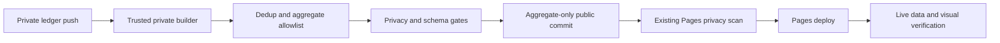

# Automatic ledger statistics publication

Issue #36. Target: 2026-11-04. Design first, no live publication in this change.

## Outcome

A change to the private filing ledger automatically produces a strictly bounded
aggregate dataset, passes the privacy gate, commits only approved public output,
and triggers the existing Pages deployment. The live page shows the latest
ledger source date and build provenance without implying live municipal status.
No municipal status API or raw source is fetched by the public repository.

## Data basis: do not invent a union

The public historical export has 977 cases through 2026-11-01. The filing ledger
has 230 rows through 2026-11-04 at inspection time, including overlapping cases,
prepared-only records and references with unverified submission-order mapping.
They are different populations. Adding those totals would double count.

Initial release keeps two explicit sections:

1. Historical municipal export: frozen snapshot through its actual last date;
   all historical status/closure figures prominently labelled as that snapshot,
   not today's open cases or proof of tickets/inspector attendance.
2. Automatically refreshed filing-ledger view: counts from documented submitted
   records, source date, pending-reference count and mapping-quality totals.
   Not described as all the resident's lifetime municipal reports.

A single combined total is deferred until a private raw historical case-key
source can be recovered and verified. Only then union on normalized municipal
case IDs, with a tested precedence policy and conflicting facts held for review.
Public aggregate files alone are insufficient for that reconciliation.

## Private input and classification

Read only the private ledger and associated report records from a trusted main
checkout. No raw files, rows, case IDs, names, house numbers, contact identity,
registry data, photos, free-text notes or paths leave that environment.

- Unique valid folder IDs identify ledger rows; duplicate IDs fail closed.
- Recognize confirmed submission from report.submission.status=submitted or an
  explicit municipal reference. Prepared-only records are excluded from filed
  counts and shown only as an aggregate preparation count if needed.
- A reference shared across folders counts once, with duplicate-row count
  disclosed. Conflicting date/category/street for one reference is a validation
  failure, not an arbitrary first/last choice.
- Submitted records without a reference form a separate pending-reference count;
  do not assert that they are distinct from already referenced cases.
- Unverified reference mappings are counted separately. Do not expose exact
  per-case mapping text, which can contain private source identifiers.
- Use filed_date for filing trends; never substitute photo time silently.
- Street normalization has tested explicit rules; no house-level hotspot output.
- No fresh closure estimate from absence of an email. New ledger view omits open
  vs closed/handling times until a clearly dated reliable status basis exists.

## Public contract and layout

A new versioned ledger aggregate carrier contains only bounded numbers, approved
category/street labels, monthly/daily counts, public build time, filing-date
coverage and a public opaque build revision. No private commit SHA or workflow
URL is necessary in the public payload. Private logs keep source provenance.

Optional repeat plates are published only after at least three confirmed distinct
cases for that plate, using the already approved plates.csv carrier. Do not add
all vehicles or registry fields from the unrelated Wix preview builder. First
release may omit ledger repeat plates until the section/filename policy cleanly
separates the historical and ledger populations. No threshold dilution.

The historical files remain unchanged. Render the ledger view as the primary
current section, with a clearly labelled link/section for the historical snapshot.
Provide source basis, latest filing day and generated timestamp in Hebrew. A
build timestamp is not a data-through/status date. Empty data and stale sources
are visible, never hidden behind a successful deploy badge.

## Publication and trust boundary

A private main-only workflow triggers on ledger/report metadata changes plus
manual dispatch. PRs run synthetic tests without public-write credentials.
Minimal read permissions; public contents writer is scoped to parking-stats only,
not inherited by checkout or arbitrary PR code. Use a fixed checked/pinned builder
revision, no execution of fetched data, no user-controlled destination/ref.

Build in a temporary directory, validate strict schema/size/types and privacy-scan
every public candidate before any public write. Re-scan the fully rendered public
site and public diff, including commit subject. Failures leave the old public
revision untouched. Public Pages keeps its independent privacy scan hard gate.
Do not disable either scan or replace failures with an empty successful payload.

A public writer must cause the existing Pages push workflow to run. Use an
approved scoped app/token with ordinary push semantics, not a default automation
token whose events may be suppressed. No secrets in artifact URLs, commit logs
or command output. No token creation or permission widening inferred here.
If the writer or runner allowance is unavailable, stop and report the exact gap.

Serialize publisher runs. Re-fetch public main before committing, preserve code
and historical files, update only the explicit ledger aggregate/rendered allowlist.
Reject unexpected diff paths. No force push or protection bypass. Identical data
is a no-op, not a new timestamp-only commit. Retry only transport conflicts with
a fresh read and same validated source; do not duplicate commits blindly.

Branch protection implications must be checked live: if all public updates need
PRs, use a normal aggregate-data PR with required checks and an approved bounded
auto-merge path. Never disable protections to make the pipeline look automatic.

## Tests and acceptance evidence

Synthetic tests cover prepared/submitted/pending/ref mapping, duplicate cases,
conflicting records, missing JSON, malformed dates/categories, Unicode street
aliases, overlap with historical data, strict payload limits and no combined sum.
Regression tests seed forbidden contact strings/raw keys into every output path
and assert zero public writes. Fail on unexpected carrier/path or plate threshold.
Test no-op, stale source, concurrent push, provider failure and Pages trigger.
Run unit+functional container tests and independent exact-head review.

Before shipping, inspect desktop and mobile pixels for source labels, historical
staleness and chart readability. Never publish synthetic cases to the real ledger.

End-to-end proof after review/green CI:

1. A genuine ledger metadata/receipt update produces a normal private push.
2. Observe its automatic builder run and privacy success, source revision and
   classified counts in private evidence.
3. Verify only allowlisted aggregate diff committed publicly and Pages ran for
   that exact commit.
4. Fetch live ledger JSON and HTML, compare counts/date/basis to the private
   builder output, inspect rendered page screenshots, report actual URLs/run IDs.
5. Confirm a repeated no-change run creates no duplicate public commit.

A dispatch-only dry run or YAML existence is not this proof. If no real ledger
change is ready, use a still-unpublished authentic acknowledgment update after
reconciling it has not already landed, not a fabricated report.

## Current checks and unresolved deployment facts

- Private preview workflow exists but produces an artifact only; it is not the
  public publisher. Its Wix output includes broader vehicle fields and is NOT
  the source for this aggregate-only publication.
- Existing public Pages deploy is push-triggered and privacy-scans before upload.
- Historical raw source location and current scoped public writer/protection
  state need source-owner verification before the execution stage.
- Account runner/billing failures were observed earlier. Actual new run results
  must establish availability; no spending or bypasses.
