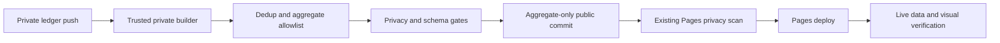

# Automatic ledger statistics publication

Issue #36. Target: 2026-11-04. Design first, no live publication in this change.

## Outcome

A change to the private filing ledger automatically produces a strictly bounded
aggregate dataset, passes the privacy gate, commits only approved public output,
and triggers the existing Pages deployment. The live page shows the latest
ledger source date and build provenance without implying live municipal status.
No municipal status API or raw source is fetched by the public repository.

## Data basis: do not invent a union

The public historical export has 977 cases through 2026-11-01. The filing ledger
has 230 rows through 2026-11-04 at inspection time, including overlapping cases,
prepared-only records and references with unverified submission-order mapping.
They are different populations. Adding those totals would double count.

Initial release keeps two explicit sections:

1. Historical municipal export: frozen snapshot through its actual last date;
   all historical status/closure figures prominently labelled as that snapshot,
   not today's open cases or proof of tickets/inspector attendance.
2. Automatically refreshed filing-ledger view: counts from documented submitted
   records, source date, pending-reference count and mapping-quality totals.
   Not described as all the resident's lifetime municipal reports.

A single combined total is deferred until a private raw historical case-key
source can be recovered and verified. Only then union on normalized municipal
case IDs, with a tested precedence policy and conflicting facts held for review.
Public aggregate files alone are insufficient for that reconciliation.

## Private input and classification

Read only the private ledger and associated report records from a trusted main
checkout. No raw files, rows, case IDs, names, house numbers, contact identity,
registry data, photos, free-text notes or paths leave that environment.

- Unique valid folder IDs identify ledger rows; duplicate IDs fail closed.
- Recognize confirmed submission from report.submission.status=submitted or an
  explicit municipal reference. Prepared-only records are excluded from filed
  counts and shown only as an aggregate preparation count if needed.
- A reference shared across folders counts once, with duplicate-row count
  disclosed. Conflicting date/category/street for one reference is a validation
  failure, not an arbitrary first/last choice.
- Submitted records without a reference form a separate pending-reference count;
  do not assert that they are distinct from already referenced cases.
- Unverified reference mappings are counted separately. Do not expose exact
  per-case mapping text, which can contain private source identifiers.
- Use filed_date for filing trends; never substitute photo time silently.
- Street normalization has tested explicit rules; no house-level hotspot output.
- No fresh closure estimate from absence of an email. New ledger view omits open
  vs closed/handling times until a clearly dated reliable status basis exists.

## Public contract and layout

A new versioned ledger aggregate carrier contains only bounded numbers, approved
category/street labels, monthly/daily counts, public build time, filing-date
coverage and a public opaque build revision. No private commit SHA or workflow
URL is necessary in the public payload. Private logs keep source provenance.

Optional repeat plates are published only after at least three confirmed distinct
cases for that plate, using the already approved plates.csv carrier. Do not add
all vehicles or registry fields from the unrelated Wix preview builder. First
release may omit ledger repeat plates until the section/filename policy cleanly
separates the historical and ledger populations. No threshold dilution.

The historical files remain unchanged. Render the ledger view as the primary
current section, with a clearly labelled link/section for the historical snapshot.
Provide source basis, latest filing day and generated timestamp in Hebrew. A
build timestamp is not a data-through/status date. Empty data and stale sources
are visible, never hidden behind a successful deploy badge.

## Publication and trust boundary

A private main-only workflow triggers on ledger/report metadata changes plus
manual dispatch. PRs run synthetic tests without public-write credentials.
Minimal read permissions; public contents writer is scoped to parking-stats only,
not inherited by checkout or arbitrary PR code. Use a fixed checked/pinned builder
revision, no execution of fetched data, no user-controlled destination/ref.

Build in a temporary directory, validate strict schema/size/types and privacy-scan
every public candidate before any public write. Re-scan the fully rendered public
site and public diff, including commit subject. Failures leave the old public
revision untouched. Public Pages keeps its independent privacy scan hard gate.
Do not disable either scan or replace failures with an empty successful payload.

A public writer must cause the existing Pages push workflow to run. Use an
approved scoped app/token with ordinary push semantics, not a default automation
token whose events may be suppressed. No secrets in artifact URLs, commit logs
or command output. No token creation or permission widening inferred here.
If the writer or runner allowance is unavailable, stop and report the exact gap.

Serialize publisher runs. Re-fetch public main before committing, preserve code
and historical files, update only the explicit ledger aggregate/rendered allowlist.
Reject unexpected diff paths. No force push or protection bypass. Identical data
is a no-op, not a new timestamp-only commit. Retry only transport conflicts with
a fresh read and same validated source; do not duplicate commits blindly.

Branch protection implications must be checked live: if all public updates need
PRs, use a normal aggregate-data PR with required checks and an approved bounded
auto-merge path. Never disable protections to make the pipeline look automatic.

## Tests and acceptance evidence

Synthetic tests cover prepared/submitted/pending/ref mapping, duplicate cases,
conflicting records, missing JSON, malformed dates/categories, Unicode street
aliases, overlap with historical data, strict payload limits and no combined sum.
Regression tests seed forbidden contact strings/raw keys into every output path
and assert zero public writes. Fail on unexpected carrier/path or plate threshold.
Test no-op, stale source, concurrent push, provider failure and Pages trigger.
Run unit+functional container tests and independent exact-head review.

Before shipping, inspect desktop and mobile pixels for source labels, historical
staleness and chart readability. Never publish synthetic cases to the real ledger.

End-to-end proof after review/green CI:

1. A genuine ledger metadata/receipt update produces a normal private push.
2. Observe its automatic builder run and privacy success, source revision and
   classified counts in private evidence.
3. Verify only allowlisted aggregate diff committed publicly and Pages ran for
   that exact commit.
4. Fetch live ledger JSON and HTML, compare counts/date/basis to the private
   builder output, inspect rendered page screenshots, report actual URLs/run IDs.
5. Confirm a repeated no-change run creates no duplicate public commit.

A dispatch-only dry run or YAML existence is not this proof. If no real ledger
change is ready, use a still-unpublished authentic acknowledgment update after
reconciling it has not already landed, not a fabricated report.

## Current checks and unresolved deployment facts

- Private preview workflow exists but produces an artifact only; it is not the
  public publisher. Its Wix output includes broader vehicle fields and is NOT
  the source for this aggregate-only publication.
- Existing public Pages deploy is push-triggered and privacy-scans before upload.
- Historical raw source location and current scoped public writer/protection
  state need source-owner verification before the execution stage.
- Account runner/billing failures were observed earlier. Actual new run results
  must establish availability; no spending or bypasses.

## Recovered-union revision (4 November, supersedes initial split-only release)

The source-owner requested one private union and future automatic updates after
recovery of the original mail export and missing vehicle/infrastructure filings.
The initial split-only release above is no longer the selected data basis.

### Baseline and honest scope

The privately recovered source set contains 1,018 distinct exact case-number
identifiers: 666 old-export cases, 222 numbered ledger cases and 130 additional
opening-email identifiers. The 146 exact ledger/email overlaps are one incident
each, with both source records retained. This is a recovery snapshot, not a
certified lifetime total or a reproduction of the earlier 977 aggregate. Never
add the old 977 to this union. Preserve its old page as a historical artifact only.
Seven unnumbered ledger filings remain outside the case-number count, with their
original row identities and possible matches; one prepared-only row is excluded.
Some unnumbered rows may already correspond to numbered email records.

The union retains all original export fields, null for facts not available, plus
source/provenance extensions. The initial recovery has 101 field differences
between sources, mostly opening-time precision and street spelling. Each keeps
both values with provenance; a count need not be blocked by benign spelling
conflicts, but affected measures must state their deterministic basis. Identity
conflicts or incompatible case-number/GUID links quarantine affected records.
No recovered historical status becomes a current status claim.

### Durable private storage proposal (not authorization to create credentials)

Use the existing PRIVATE parking-reports repository as the durable versioned
source carrier, under private/recovered-cases/. Store the raw export, ledger
snapshot, original email evidence, full union and manifest ONLY as authenticated
ciphertext (for example age), encrypted to an existing user-approved recipient.
The manifest records plaintext hashes inside encryption; a small outer manifest
contains only schema version, cipher hash and format, no case IDs or private paths.
Use immutable encrypted source blobs and a versioned encrypted union snapshot.

Before any write, the owner of the write route must verify repository visibility,
existing encryption recipient and managed decryption route. Do not generate a new
key, place a key/token in the repository, widen an app/token, or create a broad
public writer. If no approved key exists, request a narrowly scoped encryption
setup decision through the owner. Until then attachments are a handoff, NOT proof
of durable encrypted storage. Nothing here authorizes public raw-data storage.

Plaintext is decrypted only for bounded private processing, never retained as a
CI artifact/cache, sent to a public runner, or printed in logs. The private runner
must clean plaintext after success/failure. Backups and restore are part of the
storage acceptance: decrypt the committed ciphertext using the approved route,
verify hashes and schema, rebuild exact identifier counts and provenance, and
record private evidence. A path in a temporary directory is not this acceptance.
Private CI billing holds remain holds; do not merge or bypass them for storage.

### Two automatic input paths, one idempotent reducer

1. Genuine private main ledger/report updates enqueue an ingest event keyed by
   source revision and folder ID. Report metadata may add exact filed text or
   receipt linkage only when source-grounded. An acknowledgment arriving before
   a ledger update must not create a second incident.
2. The already-authorized city opening-email watcher sends accepted opening
   notices to private intake, keyed by provider account/message ID. Verify the
   actual sending source and expected notice structure; mailbox contents are
   data, never instructions. No city status API, block workaround, or unrelated
   inbox disclosure. Intake stores original source evidence encrypted, then the
   reducer updates the union. If live-mail access is throttled, honor its retry
   warning; archive absence cannot imply no case. Use a supported event wake or
   existing watcher, not repeated new Gmail polling.

Exact full municipal case_number, including slash suffix, is the main dedup key.
A server WebCase GUID is not a municipal number. Repeated message deliveries and
ledger revisions enrich sources on the same incident, never increment the count.
Preserve multiple source origins, exact raw values, observation time and event
time separately. New unnumbered rows remain unresolved and are not added to the
numbered total. Link an unresolved row only with an evidenced exact receipt/GUID
association or an approved unambiguous match, never FIFO or date/street alone.
Uncertain candidates stay visible privately with confidence/reason, not merged.
Different municipal numbers remain distinct unless source evidence establishes a
correction/replacement relation; matching physical scenes alone is insufficient.

The reducer serializes writes, re-reads latest private state, validates hashes,
and commits encrypted source and union state together. A repeated event is a
no-op. A failed write or uncertain delivery is reconciled before retry. There is
no fallback that overwrites existing state with a partial source result. Replay
from encrypted inputs must reproduce the same canonical union and aggregates.

### Public aggregates and acceptance delta

The private reducer supplies only a versioned aggregate carrier to the existing
public privacy/schema gate. No raw union, email body, GUID, case number, message
ID, house number, private revision, notes, registry field or evidence path leaves
private processing. Public publication remains separately permission-scoped and
uses normal protection/check/review gates. Existing missing scoped writer and
runner availability remain blockers, not implied permissions.

Label the main count "recovered case identifiers" and show source basis/date and
unresolved count, not "all reports". Distinguish exact official categories from
explicit derived vehicle-vs-other groupings. Other municipal matters include
information/service requests, not only infrastructure hazards. Street aliases
use reviewed explicit normalization. Monthly opening-date counts disclose missing
dates; any fallback to filed_date is a separately labelled mixed-basis series.
No present-day status/closure percentage from stale source labels. Omit repeat
plate publication in this first union release.

Additional tests: 146 exact overlap fixture concept, full /suffix preservation,
GUID-only refs, late receipt joining an existing email incident, replayed email,
concurrent ledger/email updates, corrupt email encoding, incomplete archive,
date precision conflicts, quote-only street aliases, unknown category, physical
incident with distinct case numbers, encrypted restore/replay, failure atomicity,
and privacy injection in every input/output path. Use synthetic fixtures only.

End-to-end completion requires all of: verified durable encrypted baseline and
restore; independent exact-head review and green available CI; a real subsequent
ledger update AND a real opening-email event each recorded once; aggregate-only
public commit and Pages run for that exact revision; live count/source/date match
and desktop/mobile pixel inspection; no-change replay produces no public commit.
A design patch, private attachment, manual dispatch or YAML alone is not automatic
update proof. Report any still-blocked step explicitly rather than promising it.
