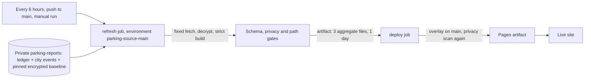

# Automatic refresh and publish

The landing page refreshes and publishes itself. It needs no card, no write
token and no paid minutes: the repository is public, so Actions minutes are
free, and nothing is ever committed or pushed to rebuild the data.

## What runs

`.github/workflows/pages.yml` has two jobs.

1. `refresh` (environment `parking-source-main`, only `main`, only this
   repository). It fetches the private source with a read-only token, decrypts
   the pinned baseline, builds the aggregate with `source_refresh`, renders
   `public/index.html` with `recovered_page`, and runs the privacy scan, the
   exact-path diff gate and the strict schema gate. It uploads exactly
   `index.html`, `data/recovered-summary.json` and `data/source-freshness.json`
   as a one-day artifact and always deletes keys, plaintext and checkouts.
2. `deploy` (environment `github-pages`, no secrets). It downloads the artifact,
   refuses anything but those three regular files, copies them over `public/`,
   scans `public/` again and re-validates the aggregates. After uploading the
   attempt-specific Pages tar, it checks the run's artifact metadata for the
   exact upload ID/name, positive size. Missing metadata
   gets at most seven read-only checks, five seconds apart (30 seconds total
   waiting); malformed, duplicate or mismatched listings fail
   closed. HTTP errors fail immediately. Only then does one deployment run.
   This handles observed metadata lag without repeating deployment writes.
   The local Node action uses the runner's runtime credential with the same
   internal `ListArtifacts` service as pinned `deploy-pages`, not the REST API
   (whose visibility can differ). It adds no repository-token permissions,
   prints no credentials/scopes/response bodies and refuses redirects. Its
   JavaScript is dependency-free. Offline tests use invented metadata only.

The deploy job fails closed: if the refresh fails, nothing is deployed and the
previous live site stays. A manual run with `refresh=false` deploys the
committed snapshot as is.

Because the refreshed files are overlaid at deploy time and not committed, the
committed `public/data/recovered-summary.json` and `public/index.html` are only
a fallback snapshot. Every push to main also refreshes, so merging code never
rolls the live data back.

## Private inputs

| Input | Where | Used for |
| --- | --- | --- |
| `ledger/reports.csv` | `parking-reports` main | filing rows, street, opening date |
| `reports/<folder>/report.json` | `parking-reports` main | validated, never promoted to facts |
| `ledger/stats-city-events.json` | `parking-reports` main | city opening receipts (below) |
| `private/recovered-cases/union.json.age` | pinned commit | encrypted historical baseline |

`ledger/stats-city-events.json` is `{"schema_version": 1, "snapshot_at": <aware
timestamp>, "events": [...]}`. Each event is
an object with the keys `origin` (always `city_email`), the full municipal
number, `source_id`, `observed_at` and `fields`, with `fields` limited to `createdon`, `streetname` and `subjectname`. No names,
plates or message bodies. A missing file means no city events. Any other shape
fails the whole refresh. Events join the baseline by exact full case number, so
an email receipt and a ledger row for the same case count once, and conflicting
dates or labels become "unknown" instead of one source winning.

Ledger rows are handled conservatively:

- `ref_mapping=unverified_fifo` rows never provide a case number. They count as
  "ledger rows without a verified individual case join". The independent city
  events carry those case numbers.
- A UUID in `municipal_event_number` is a transport id, not a case number.
- Two different valid case numbers on one verified row still fail closed.
- Surplus empty CSV cells are tolerated; a non-empty overflow cell fails.

## Public output

Counts only: totals, months, reviewed street and category labels (everything
else is "other / unknown"), and timestamps. Freshness (schema version 2) says
when the ledger was read, when the historical baseline was taken and when the
city receipts were saved, and states `live_city_status: false`. City status and
closure are never presented as current.

## Failure and cost

Failures print only a stage and a code (no source values). Cost is about two
minutes per run on a free public runner, four runs a day plus one per merge.
GitHub pauses scheduled workflows after 60 days without repository activity;
a manual run (Actions, Pages, Run workflow) wakes them.
